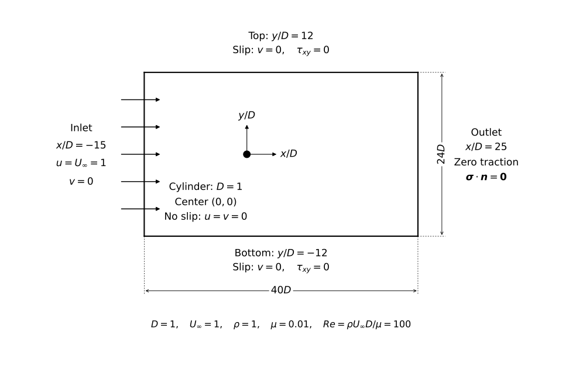

# 2D flow past cylinder at Re=100: svMultiPhysics benchmark

This benchmark generates a triangular mesh, runs 2D incompressible flow past cylinder at Re = 100, and compares mean drag and Strouhal number with literature values. The default configuration supports coarse, medium, and fine presets, plus custom domains and regional mesh sizes.

## Problem setup

The default domain size and boundary conditions are shown below. The cylinder is centered at the origin, and lengths are normalized by its diameter $D$. Here, $u$ and $v$ are the streamwise ($x$) and transverse velocity ($y$) components, respectively.



The meshes use linear triangular (TRI3) elements generated with Gmsh's Frontal-Delaunay algorithm (6). The default simulations use a time step of $0.005$ for $30,000$ steps, reaching $t = 150$. 

## Requirements

- Python 3.10 or newer and the packages in [requirements.txt](requirements.txt).
- svMultiPhysics available as `svmultiphysics` on `PATH`, or supplied with `--solver`.
- An MPI launcher available as `mpirun` on `PATH`, or supplied with `--mpi-exec`.

Install dependencies in your Python environment:

```bash
python -m pip install -r requirements.txt
```

Run all commands below from the repository root using that environment's Python.

## Default presets

| Preset | Nodes | Elements | Cylinder wall | Near-wall outer | Far upstream | Upstream | Approach | Initial wake | Middle wake | Extended wake | Transition | Outlet | Far field |
|---|---:|---:|---:|---:|---:|---:|---:|---:|---:|---:|---:|---:|---:|
| coarse | 23,837 | 47,327 | 0.012375 | 0.18 | 1.53 | 0.81 | 0.18 | 0.063 | 0.0855 | 0.12375 | 0.2475 | 0.495 | 1.575 |
| medium | 54,050 | 107,582 | 0.00825 | 0.12 | 1.02 | 0.54 | 0.12 | 0.042 | 0.057 | 0.0825 | 0.165 | 0.33 | 1.05 |
| fine | 120,353 | 239,933 | 0.0055 | 0.08 | 0.68 | 0.36 | 0.08 | 0.028 | 0.038 | 0.055 | 0.11 | 0.22 | 0.70 |

All regional sizes are target element sizes $h/D$. Preset cases are saved as `preset_coarse`, `preset_medium`, and `preset_fine`.

Mesh targets are defined in [benchmark_default_config.json](benchmark_default_config.json); solver settings are in [solver_template.xml](main/run/solver_template.xml).

## Running cases

Run a preset; coarse is the default if no preset name is provided:

```bash
python main/run/run_case.py coarse
python main/run/run_case.py medium
python main/run/run_case.py fine
```

Specify executable paths and the MPI process count when needed (`--np` defaults to 8):

```bash
python main/run/run_case.py coarse \
  --solver /path/to/svmultiphysics --mpi-exec /path/to/mpirun --np 8
```

For a custom case, omit the preset name and specify target element size in a region. Unspecified settings inherit coarse defaults:

```bash
python main/run/run_case.py \
  --domain-x -40 20 --domain-y -30 30 \
  --wall-size 0.01 --initial-wake-size 0.05 --case-name custom_case
```

Lengths are in cylinder diameters. Expanding the domain keeps refinement locations fixed and extends the endpoint size targets. `--far-size` also sets the global size maximum; other element-size targets must not exceed it. Use `python main/run/run_case.py --help` for all options and preset values.

A custom JSON file can also provide settings:

```json
{
  "geometry": {"domain_x": [-40, 20], "domain_y": [-30, 30]},
  "mesh": {"wall_size": 0.01, "initial_wake_size": 0.05}
}
```

```bash
python main/run/run_case.py --config /path/to/custom.json
```

Settings take precedence in this order: coarse defaults, custom JSON, then explicit command-line domain/mesh values.

Here we also included a custom mesh generation example with larger domain size and cross band refinement. Reproduce the cross-refined `custom_fine_70D_50D` mesh in a fresh output directory:

```bash
python3 main/run/run_case.py \
  --case-name custom_fine_70D_50D \
  --results-dir /private/tmp/cylinder-reproduction \
  --domain-x -25 45 --domain-y -25 25 \
  --wall-size 0.0055 \
  --near-wall-distance 1 --near-wall-outer-size 0.08 \
  --far-upstream-size 0.028 \
  --upstream-size 0.028 --approach-size 0.028 \
  --initial-wake-size 0.028 --middle-wake-size 0.028 \
  --extended-wake-size 0.028 \
  --transition-size 0.028 --outlet-size 0.028 \
  --wake-half-width 3 --wake-blend-width 1 \
  --vertical-size 0.055 \
  --vertical-half-width 3 --vertical-blend-width 1 \
  --far-size 0.175 --distance-sampling 960 \
  --prepare-only
```


Generate inputs without CFD, or postprocess saved results:

```bash
python main/run/run_case.py fine --prepare-only
python main/run/run_case.py --postprocess-only --case-name custom_case
python main/run/run_case.py --postprocess-only --case-dir results/<case-directory>
```

Existing cases reuse their saved settings and inputs. Choose a new `--case-name` or `--results-dir` when changing settings for an independent run. Automatic custom names encode domain dimensions and wall size, for example `custom_40D_24D_hwall0.012`.

The solver is skipped when a nonempty .vtu reaches the configured final step. Otherwise, the saved `solver.xml` controls restarting: `Continue_previous_simulation=true` resumes from restart data; `false` starts from scratch.

## Outputs

```text
benchmark_default_config.json
main/
  run/
  mesh/
  postprocessing/
literature/
results/<case-directory>/
  case_config.json
  solver.xml
  mesh/
    figures/
  solver_output/             # .vtu and restart data
  figures/
  tables/
  summary.json
  run.log
```

Paths below are relative to each case directory:

| Output | Contents |
|---|---|
| `mesh/figures/` | Full-domain, near-cylinder, and near/middle-wake mesh views |
| `mesh/mesh_generation_report.json` | Mesh parameters, verification results, and generation warnings or errors |
| `figures/force_history.png` | Drag and lift histories with mean drag and lift coefficients, and Stouhal number |
| `figures/ux_step_*.png`, `figures/pressure_step_*.png`, `figures/vorticity_step_*.png` | Flow fields visualization at final time step |
| `figures/wall_cp_theta.png` | Surface pressure coefficient averaged over the selected shedding cycles and the upper and lower surfaces |
| `tables/force_history.csv` | Drag and lift coefficients |
| `tables/wall_cp_theta.csv` | Angle in degrees and mean surface pressure coefficient used in the wall-pressure plot |
| `tables/metrics.csv` | Mean drag and St values with their literature comparison status |
| `summary.json` | Simulation statistics, literature comparison status, and run-quality diagnostics |
| `run.log` | Solver output, also printed live in the terminal |

## Validation

2D flow past a circular cylinder at $Re=100$ is a well-established benchmark in CFD. Here, we assess svMultiPhysics against published studies with comparable domain sizes, mesh resolutions, and numerical methods. Pointwise agreement between flow fields is not expected, the mean drag coefficient ($\overline{C_D}$), RMS lift coefficient ($C_{L,\mathrm{RMS}}$), and Strouhal number ($St$) serve as the primary comparison metrics and determine the PASS/FAIL outcome in svbenchmark.

| <sub>Paper</sub> | <sub>Domain size (D)</sub> | <sub>Mean drag (CD)</sub> | <sub>Lift RMS (CL,RMS)</sub> | <sub>Strouhal (St)</sub> | <sub>Numerical method</sub> |
| :---: | :---: | :---: | :---: | :---: | :---: |
| <sub>[Tumkur et al. (2013)](https://doi.org/10.1016/j.jfluidstructs.2013.03.008)</sub> | <sub>48 × 24</sub> | <sub>1.360</sub> | <sub>-</sub> | <sub>0.168</sub> | <sub>FEM</sub> |
| <sub>[Kamensky et al. (2015)](https://doi.org/10.1016/j.cma.2014.10.040)</sub> | <sub>40 × 20</sub> | <sub>1.381</sub> | <sub>-</sub> | <sub>0.171</sub> | <sub>FEM</sub> |
| <sub>[Tsetoglou et al. (2025)](https://doi.org/10.1002/fld.5334)</sub> | <sub>65 × 30</sub> | <sub>1.335</sub> | <sub>0.237</sub> | <sub>0.167</sub> | <sub>FVM</sub> |
| <sub>[Deng et al. (2019)](https://doi.org/10.1103/PhysRevE.100.053107)</sub> | <sub>46 × 32</sub> | <sub>1.374</sub> | <sub>-</sub> | <sub>0.164</sub> | <sub>FVM</sub> |
| <sub>[Qu et al. (2013), Table 1](https://doi.org/10.1016/j.jfluidstructs.2013.02.007)</sub> | <sub>-</sub> | <sub>1.318–1.336</sub> | <sub>0.222–0.235</sub> | <sub>0.164–0.166</sub> | <sub>-</sub> |

## Wall time

The following wall times were recorded for 30,000 timesteps, excluding mesh generation and postprocessing.

| Case | Hardware | MPI ranks | Wall time (hours) |
| :---: | :---: | :---: | :---: |
| `preset_coarse` | MacBook M5 Pro | 16 | 0.43 |
| `preset_medium` | MacBook M5 Pro | 16 | 1.10 |
| `preset_fine` | MacBook M5 Pro | 16 | 2.94 |
| `custom_fine_70D_50D` | Stampede3 HPC (1 node) | 112 | 14.80 |

These times include saving/writing `.vtu` results during the run. In the recorded cases, output was enabled from the beginning (`Start_saving_after_time_step = 1`) and written every 10 timesteps (`Increment_in_saving_VTK_files = 10`), as defined in each case's `solver.xml`. Users may reduce output-writing overhead by increasing `Start_saving_after_time_step` in `solver.xml` before running a case. However, it is also important to keep enough saved timesteps to establish periodic shedding and cover several complete cycles for validation.
